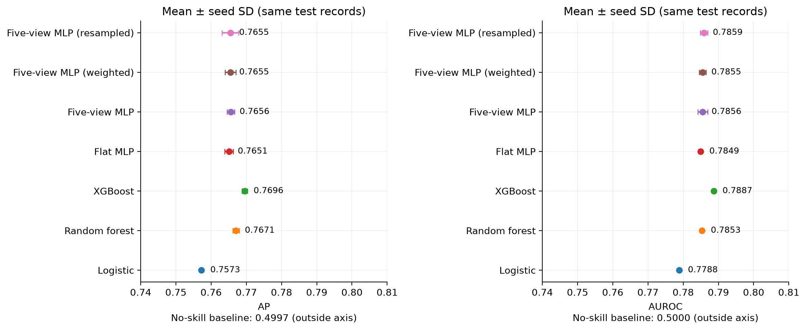
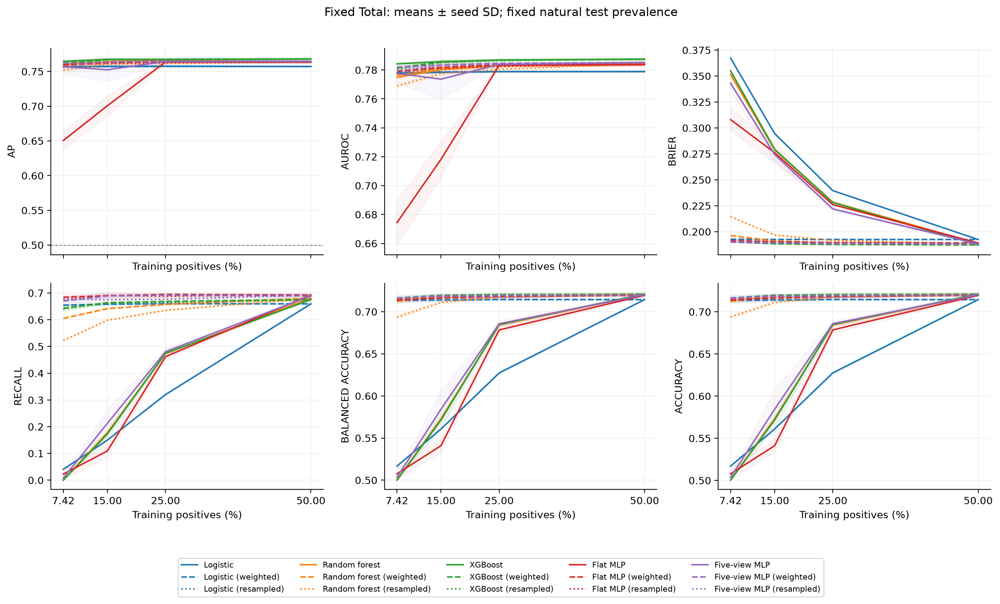

# Cardiovascular 70K multiview benchmark

A standalone, reproducible research benchmark of **cross-sectional cardiovascular disease
label classification**, with five-view neural learning and controlled training prevalence.
This is a new study, separate from
[HAALSI→MHAS selective-transfer research](https://github.com/pm2m1/cvd-selective-transfer-research).
It is not Phase 1 external validation, prospective event prediction or a clinically validated
risk tool.

## Questions and design

1. How does a five-view MLP compare with logistic regression, random forest, XGBoost and a
   capacity-matched ordinary MLP on the same features and partitions?
2. How do ranking, probability calibration and operating performance change when training
   positives fall to 50%, 25%, 15% and 7.42%?
3. Do training class weighting, random oversampling and validation-selected thresholds help?
4. Is there measurable multiview benefit beyond an ordinary MLP?

**Primary outcome: average precision (AP)**, interpreted against the held-out prevalence.
AUROC, Brier score, log loss, balanced accuracy, sensitivity, specificity, precision, F1,
ECE, confusion counts, duration and parameter count are secondary/descriptive. Accuracy
does not select a winner. Protocol and primary decisions were locally prespecified and
hashed before final test predictions; this is not an externally registered trial.

## Dataset and release boundary

[Cardiovascular Disease dataset](https://www.kaggle.com/datasets/sulianova/cardiovascular-disease-dataset),
Svetlana Ulianova, Kaggle version 1 (2019-01-20). The supplied archive contains one
semicolon-separated CSV, **70,000 rows × 13 columns**, including 34,979 positives and
35,021 negatives. The recorded disease label and features were collected at examination.
Clinical source cohort, adjudication, consent and site metadata are not established.

**Official Kaggle metadata lists the dataset licence as “Unknown.”** This project grants
no permission to redistribute it. Raw data, row/group assignments, row predictions,
checkpoints and fitted preprocessing remain local and ignored. Public content consists of
original code, invented test fixtures, original non-reconstructive aggregate statistics,
figures and documentation; no actual participant examples are included. Read
[provenance and release limits](docs/provenance_and_release.md) before reuse.

ZIP integrity and decompression safety are checked before extraction. The raw archive is
never modified or substituted. [The audit](docs/dataset_audit.md) documents types, categories,
ranges, duplicate/conflicting labels, all cleaning reasons and actual split counts.

## Leakage control and preprocessing

Twenty approximately stratified feature-group folds produce roughly 70/15/15 training,
validation and final test membership. Raw and post-masking feature-identical observations,
including conflicting labels, stay together. A row ID is excluded and is not assumed to
be a verified person identifier. Test membership is frozen before model fitting.

The primary minimal dataset retains all records and masks invalid measurements under
fixed broad research plausibility checks. Training medians and scaling are fitted only on
each run's training subset. Strict sensitivity excludes 1,397 flagged records, retaining
68,603. No data cleaning rule is selected using test performance. Age is converted from
days to years; BMI is calculated only from valid height/weight. Cholesterol/glucose use
one-hot category encodings. Held-out sets are never rebalanced.

## Architectures and equal tuning budget

|View|Inputs after encoding|Encoder width|
|---|---|---|
|Background|Age years, gender code (2)|16|
|Haemodynamic|Systolic, diastolic BP (2)|16|
|Anthropometric|Height, weight, derived BMI (3)|16|
|Metabolic|Cholesterol/glucose category indicators (6)|16|
|Behaviour|Smoking, alcohol, physical activity (3)|16|

Five encoders use Linear→ReLU→LayerNorm. Their concatenated 80 outputs pass through fusion
widths 64 and 32 and one binary logit: **7,985 trainable parameters**. The flat MLP uses the
same 16 inputs and widths 96,64: **8,225 parameters**. BMI-only and height/weight-only
sensitivities check redundancy from the derived BMI input.

Two validation-AP candidates per standard model family; selected settings are reused
without extra intervention/condition-specific tuning. Logistic L2 C {0.1,1}; RF 200 trees,
minimum leaf 10, depth {8,unlimited}; XGBoost ≤600 trees, depth {3,5}, learning rate .05,
subsample and column fraction .9; neural AdamW lr {.001,.0003}, weight decay .0001,
batch 1024, ≤60 epochs. Neural early stopping uses natural-validation BCE, patience 8,
and restores the best eligible checkpoint. Scratch epoch zero is logged but ineligible.
XGBoost stops on validation log loss, patience 30. Five paired seeds: 101,202,303,404,505.

MPS is used after actual finite-optimization and CPU-gradient parity checks. On the
completed Apple M5 Pro run, MPS was reliable; CPU was faster in the tiny probe. Tree and
linear models use CPU. XGBoost is isolated in a tested process to avoid a local
PyTorch/OpenMP native-library conflict. All predictions and metrics are genuine fitted
model outputs; no synthetic observations are presented as study findings.

## Two complementary imbalance analyses

- **A, fixed total:** 26,478 training records. Positive counts are 13,239; 6,620; 3,972;
  1,965 at the four fractions. Positive and negative support necessarily change together.
- **B, fixed positives:** 1,964 positive examples, with totals 3,928; 7,856; 13,093;
  26,469. This changes negative support and total size. The rare-prevalence condition limits
  the common positive count because only 24,514 training negatives are available.

Each design uses the original train pool, five paired seeded/nested without-replacement
samples, all five model families, and standard, class-weighted and random-oversampled
training: **600 fits**. Validation and test remain fixed at natural approximately 50%
prevalence. Oversampling adds minority repeats only in training; no SMOTE is used.
7.42% resembles MHAS prevalence only and does not reproduce MHAS data or domain shift.
Neither design isolates a causal prevalence effect independent of example support.

## Completed empirical results

**690 actual fits completed:** 10 search + 680 final models, including all 600 imbalance
fits. The validation-selected winner is **XGBoost** (validation mean AP 0.785829). Final
results below are means over five paired seeds on the same 10,501 held-out records,
including 5,247 positives. The AP prevalence baseline is **0.499667**.

| Model | AP | AUROC | Brier | Recall @.50 | Balanced accuracy @.50 |
| --- | --- | --- | --- | --- | --- |
| Logistic | 0.7573 | 0.7788 | 0.1925 | 0.6600 | 0.7143 |
| Random forest | 0.7671 | 0.7853 | 0.1882 | 0.6794 | 0.7215 |
| XGBoost | 0.7696 | 0.7887 | 0.1870 | 0.6773 | 0.7216 |
| Flat MLP | 0.7651 | 0.7849 | 0.1886 | 0.6891 | 0.7200 |
| Five-view MLP | 0.7656 | 0.7856 | 0.1883 | 0.6935 | 0.7192 |
| Five-view MLP (weighted) | 0.7655 | 0.7855 | 0.1883 | 0.6896 | 0.7203 |
| Five-view MLP (resampled) | 0.7655 | 0.7859 | 0.1880 | 0.6842 | 0.7208 |

Standard five-view minus flat-MLP AP: descriptive paired feature-group-bootstrap 95% CI
**−0.00263 to +0.00381**, using 1,000 draws. Multiview superiority is not established.
XGBoost's AP interval is [0.75668, 0.78417]. Seed variation and group-bootstrap uncertainty
refer to the same internal population, not independent cohort validation.

At 7.42% training prevalence in A, standard five-view recall @.50 is 0.0079 and Brier
0.3431. Weighting yields recall 0.6702 and Brier 0.1899, with AP changing 0.7570→0.7616.
A validation-selected threshold alone raises standard-model balanced accuracy from
0.5034 to 0.7118; AP and Brier are unchanged by thresholding. In B, standard AP stays
approximately 0.755 at both endpoints despite changing prevalence, consistent with a
more complicated role for example support and training-prior mismatch. These are
observations, not causal prevalence effects or deployment-calibration evidence.

The standard flat MLP restores epoch 1 in all ten rarest-prevalence fits under the fixed
natural-validation BCE stopping rule. Its low AP there must be interpreted within this
specific stopping/tuning protocol, not as an intrinsic failure of flat representations.

The winning XGBoost's validation-selected thresholds for seeds 101/202/303/404/505 are
0.44/0.48/0.46/0.45/0.45. Selection maximizes validation balanced accuracy; final test values
do not revise these points. Selected hyperparameters: LR C=1; RF depth unlimited;
XGBoost depth 5; flat MLP lr=.0003; multiview lr=.001.

Primary split train/validation/test: **48,999 / 10,500 / 10,501**. Strict sensitivity:
**48,039 / 10,288 / 10,276**. Forty-one duplicate-feature groups include 17 with conflicting
labels; all are isolated within partitions. No raw or modeled group crosses a split.





[Complete report with uncertainty and sensitivities](docs/results.md) ·
[All model metrics](results/aggregate/test_metrics.csv) ·
[Full imbalance table](results/reports/imbalance_multiview.md) ·
[Figure gallery](results/figures/README.md)

## Reproduce

Install Python 3.12, uv, and a working XGBoost/OpenMP runtime. Obtain the dataset yourself
from Kaggle under its applicable terms; no replacement data are downloaded.

```sh
uv sync --frozen
uv run ruff check .
uv run ruff format --check .
uv run pytest -q
uv run python scripts/reproduce.py --archive '/absolute/path/to/archive(1).zip'
```

This executes the complete benchmark in a fresh timestamped ignored workspace under
`private/reproductions/`, preserving the released results. It performs archive inspection,
preparation, device probing, development, checksum lock, final evaluation, paired bootstrap,
figures and reports. See [exact stages and safeguards](docs/reproducibility.md).

## Repository map

- `src/cvd70k/`: data, models, training, evaluation, experiments and visualization.
- `configs/benchmark.json`: the executed experiment budget and settings.
- `tests/`: invented fixtures, numerical/leakage/selection tests and released-output checks.
- `results/aggregate/`: per-model aggregate metrics, curves, audit, manifests and uncertainty.
- `results/figures/`: publication PNG/PDF figures and diagnostics for every model condition.
- `results/reports/`: complete generated report and model/sensitivity/imbalance tables.
- `docs/`: [protocol](docs/experiment_protocol.md), [methodology](docs/methodology.md),
  [dictionary](docs/data_dictionary.md), [results](docs/results.md),
  [limitations](docs/limitations.md), [reproduction](docs/reproducibility.md).

Five training seeds reuse one test population. Feature-group bootstrap accounts for exact
record duplication but cannot recover unknown participant linkage. The modest search budget,
unknown clinical provenance, artificial training/test-prior mismatch and multiple descriptive
comparisons constrain interpretation. No genuine acquisition sites or independent cohorts
are identified, so no selective-adaptation or transfer experiment is manufactured. Such
experiments require a defensible separately designed future study.
